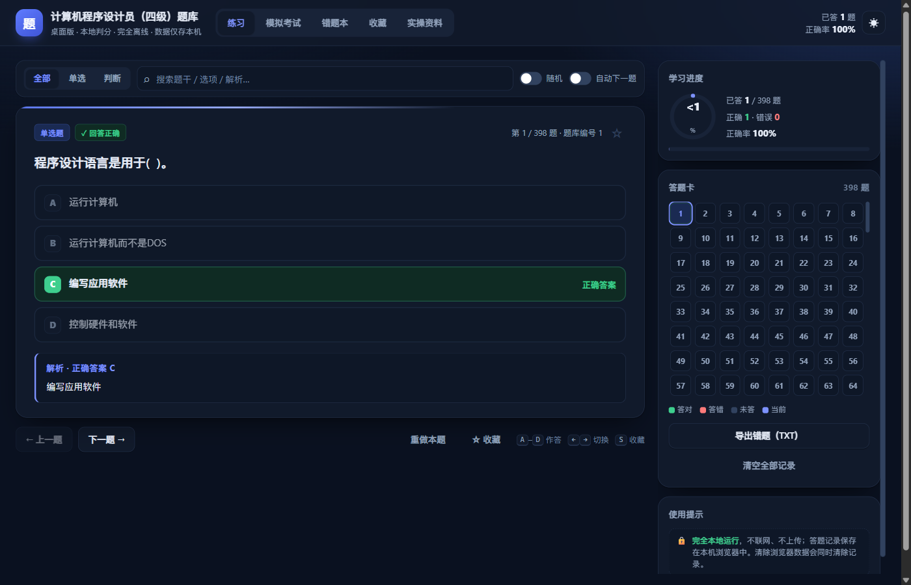
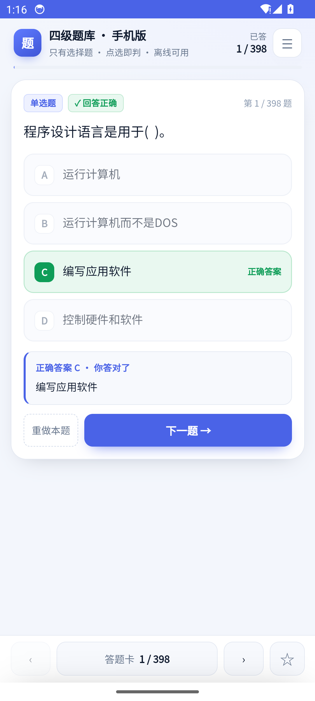
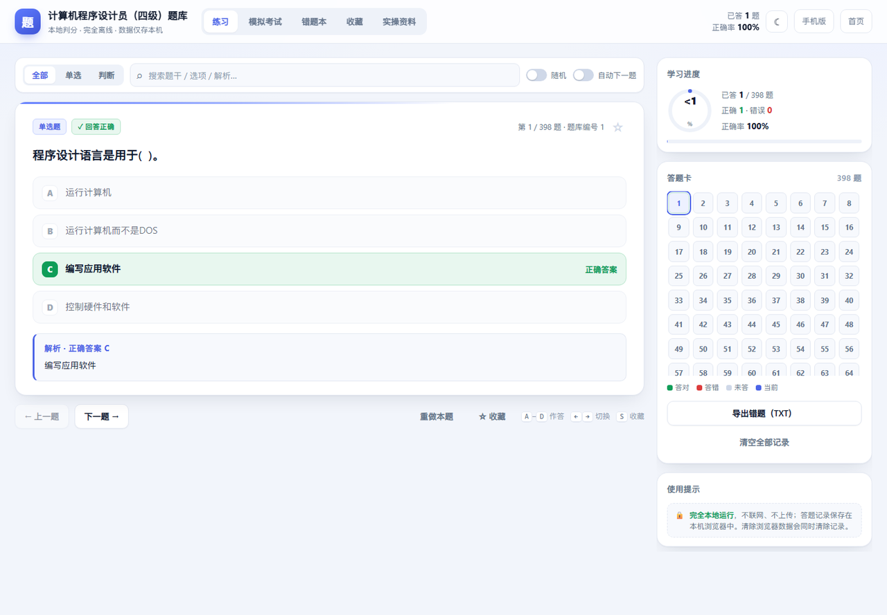
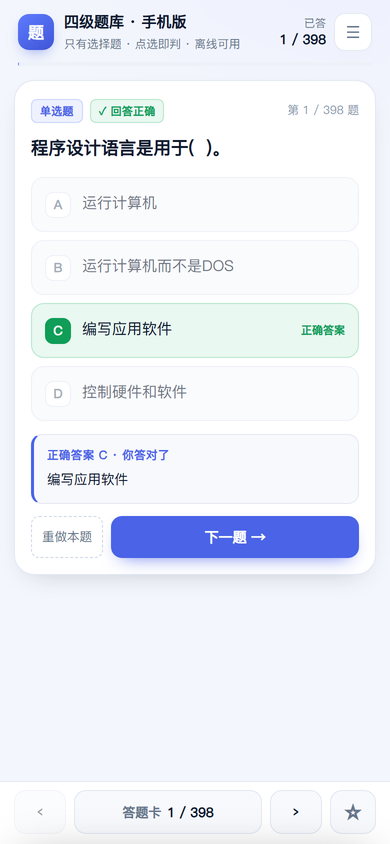

# 计算机程序设计员（四级）题库

> 面向使用者的完整说明（安装、权限、数据位置、常见问题）：[使用说明.md](使用说明.md)

一套离线题库，四种用法：

| 版本 | 获取方式 | 特点 |
| --- | --- | --- |
| Windows 桌面版 | [Tiku-Desktop-1.0.0.exe](https://github.com/xk464/computer-programmer-4-question-bank/releases/download/v1.0.0/Tiku-Desktop-1.0.0.exe) | 双击运行，自包含 .NET 运行时；本地判分、模拟考试、错题本、收藏、搜索、5 个互动实操、F11 全屏 |
| Android 手机版 | [Tiku-Android-1.0.0.apk](https://github.com/xk464/computer-programmer-4-question-bank/releases/download/v1.0.0/Tiku-Android-1.0.0.apk) | **只有选择题**，大按钮点选即判、滑动切题、答题卡，完全离线且不申请网络权限 |
| 电脑网页版 | [`pc/index.html`](pc/index.html) | 免安装，浏览器直接打开，功能与桌面版一致 |
| 手机网页版 | [`mobile/index.html`](mobile/index.html) | PWA，可「添加到主屏幕」离线使用 |

在线访问：<https://xk464.github.io/computer-programmer-4-question-bank/>

## 下载安装

- **Windows**：下载 `Tiku-Desktop-1.0.0.exe`（约 64 MB）双击运行，无需安装 .NET。程序未做代码签名，SmartScreen 提示时选择「更多信息 → 仍要运行」。需要系统已安装 WebView2 运行时（Windows 11 自带，Windows 10 可通过系统更新安装）。
- **Android**：下载 `Tiku-Android-1.0.0.apk`（约 85 KB），允许「安装未知应用」后安装。使用 debug 签名，仅适合个人学习与侧载；上架应用商店需自行替换为 release 签名。应用不申请网络权限，所有题目与记录都在本机。









## 功能

- **398 道题**：单选题 306 道 + 判断题 92 道（原始 Excel 400 题，2 题因缺图且无答案未收录）。
- **本地判分**：点选选项立即显示对错、正确答案与解析；「答案存疑」的题目标有 ⚠ 提示。
- **模拟考试**：随机组卷（20 / 50 / 100 / 全部），计时、交卷判分、成绩记录，错题自动入错题本。
- **错题本**：按错误次数归集，答对自动移除，可导出 TXT。
- **收藏与搜索**：星标重点题，按题干 / 选项 / 解析全文检索。
- **实操模拟（桌面版）**：按真实安装器页序练习：Sublime 为“解压 zip → 选择安装位置 → 开始菜单文件夹 → 安装 → 完成”（无欢迎/许可页），再手动“发送到桌面快捷方式”；VS Code 为“许可 → 位置 → 开始菜单 → 附加任务（勾选创建桌面快捷方式）→ 安装 → 完成”。安装写入**应用内虚拟机**（虚拟磁盘 C:、开始菜单、桌面和注册表），启动自动恢复“考试起始状态”快照；桌面内置 `SublimeText.zip` / VS Code 安装包，先模拟解压再安装；可打开“虚拟机文件”查看，关机丢弃改动。内置真实向导截图可对照，另有 html+Tab、F5、流程图、C 本地运行、详细设计填空。F11 全屏。
- **完全离线**：无后端、无登录、无广告；答题记录保存在浏览器 `localStorage`，不上传任何数据。
- **PWA**：手机版支持「添加到主屏幕」，首次打开后可断网使用。

## 目录结构

```
├── index.html              # 落地页（两个版本入口）
├── 使用说明.md             # 使用者文档（安装 / 权限 / 数据 / FAQ）
├── SHA256SUMS.txt          # 安装包校验值
├── pc/index.html           # 电脑版应用
├── mobile/index.html       # 手机版应用（PWA）
│   ├── manifest.webmanifest
│   ├── sw.js               # 离线缓存
│   └── icons/
├── assets/
│   ├── bank.js             # 由 data/ 生成的题库数据（window.QBANK）
│   ├── favicon.png
│   └── qr-mobile.png
├── data/
│   ├── questions.json      # 清洗后的题库
│   └── practical.json      # 实操资料
├── source/                 # 原始文件（Excel / Word）
├── dist/                   # 离线单文件版本
├── desktop/                # Windows 桌面版（.NET 8 + WebView2 + 内置 TinyCC）
├── android/                # Android 原生壳（WebView 加载内置题库）
├── docs/                   # 预览图
├── release/                # 构建产物（exe / apk，不提交）
└── tools/                  # 数据、桌面端、APK、图标与二维码构建脚本
```

## 本地使用

直接用浏览器打开 `index.html` 即可（`file://` 也能运行，题库无需请求后端）。手机版建议通过 HTTP 访问以启用 PWA：

```bash
python -m http.server 8000
# 打开 http://localhost:8000/
```

## 重新构建数据

```bash
python tools/build_data.py      # Excel → data/questions.json
python tools/build_assets.py    # data/*.json → assets/bank.js
python tools/build_dist.py      # 生成 dist/ 离线单文件
```

需要 `openpyxl`、`python-docx`；图标与二维码脚本另需 `Pillow`、`qrcode`。

## 构建 Windows 桌面版

需要 .NET 8 SDK 与 Windows。桌面端使用 WebView2 渲染同一套网页，并把网页资源嵌入 exe：

```bash
python tools/build_desktop_web.py
dotnet publish desktop/TikuDesktop.csproj -c Release -r win-x64 --self-contained true \
  -p:PublishSingleFile=true -p:IncludeNativeLibrariesForSelfExtract=true \
  -p:EnableCompressionInSingleFile=true -o release/desktop
```

产物 `release/desktop/TikuDesktop.exe` 为单文件自包含程序（约 65 MB），目标机器需要 WebView2 运行时。程序优先把题库与答题记录写入 `%LOCALAPPDATA%\ComputerProgrammer4Tiku`，若该目录不可写会自动回退到 exe 同级的 `TikuData`，也可用环境变量 `TIKU_DATA_DIR` 指定。

桌面版内置 TinyCC 0.9.27 用于本地编译 C 代码（LGPL 2.1），打包在 `desktop/tcc.zip`，许可证见 `desktop/tcc-COPYING.txt`。

## 构建 Android APK

需要 JDK 17、Android SDK（build-tools 34、platform 34）。`aapt2` 不支持中文路径，因此脚本会先把工程复制到 `C:\tiku-apk` 并在 `C:\android-sdk` 下调用 SDK：

```bash
python tools/make_android_icons.py
python tools/build_android_web.py
python tools/build_apk.py
```

脚本依次执行 aapt2 资源编译、javac、d8、zipalign、apksigner，首次运行会生成 `android/debug.keystore` 用于调试签名，产物为 `release/Tiku-Android-1.0.0.apk`。

## 数据说明

- 原始题库：`source/question-bank.xlsx`（400 题）。
- 第 **168、299** 题引用了「如图所示的伪代码 / 程序框图」，源文件缺少配图且无答案，无法判分，未收录。
- 8 道题在原表中备注「答案存在歧义」或「选项疑有笔误」，界面中以 ⚠ 标记，请以教材与考官口径为准。
- 实操资料依据 `source/practical.docx` 整理，保留原题表述，仅修正明显录入错字。

## 许可

代码以 MIT 许可发布；题库内容版权归原作者 / 出版方所有，本项目仅供个人学习复习使用。
